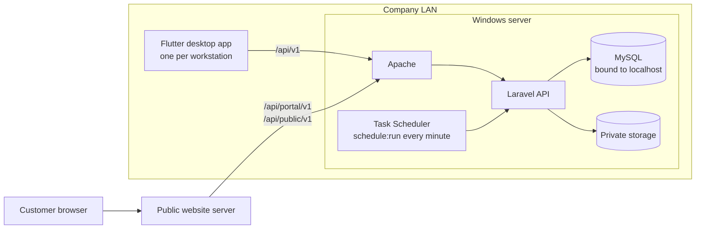
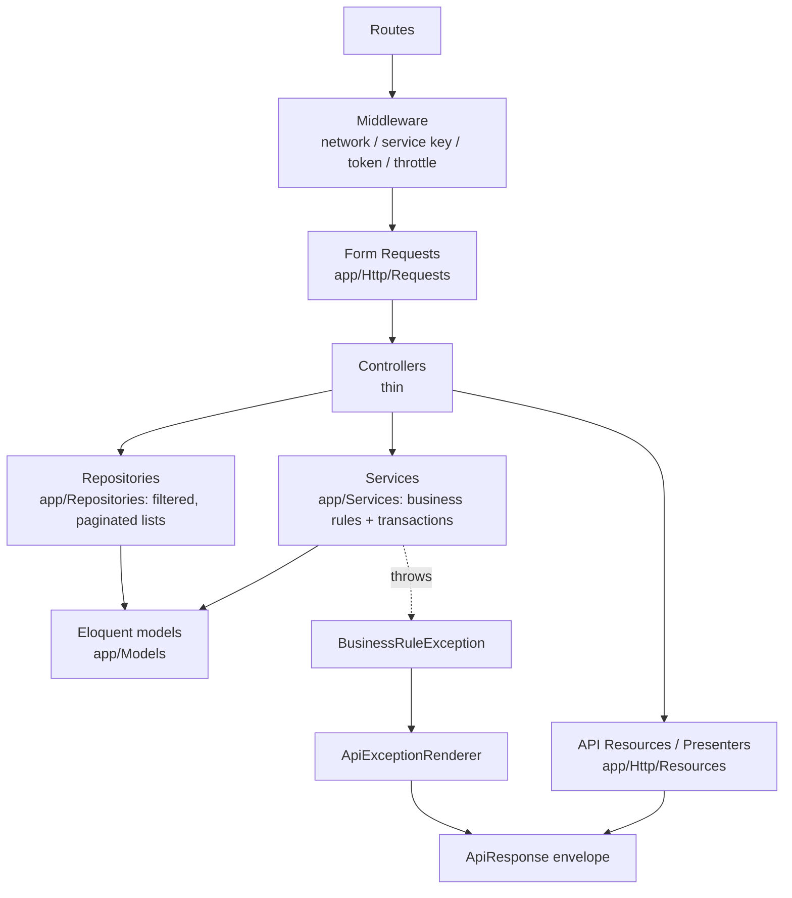
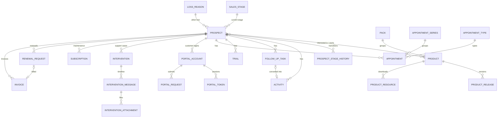
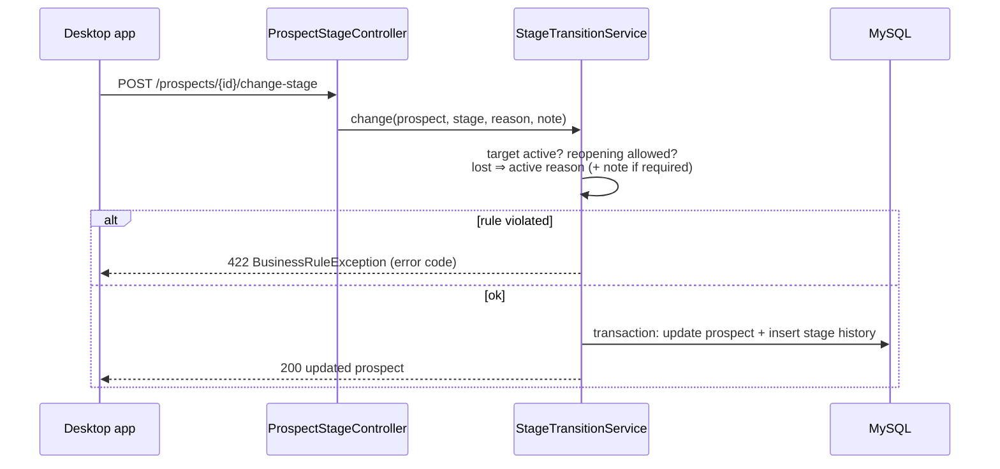
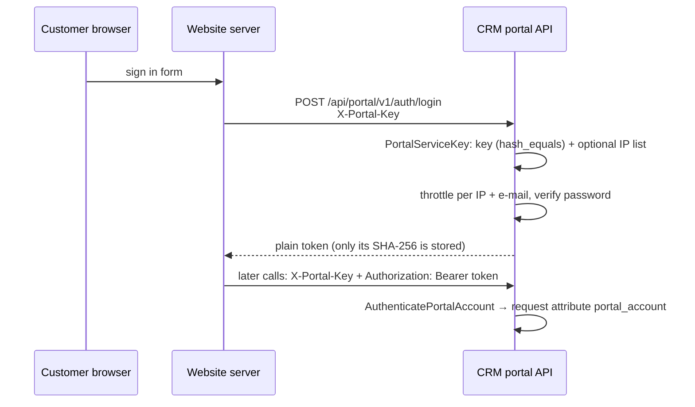

# Architecture

This document explains how the SOFTEL CRM backend is organised and why. For the
endpoint-level contract see [docs/API.md](docs/API.md) and
[docs/PORTAL_AND_WORKFLOWS.md](docs/PORTAL_AND_WORKFLOWS.md).

## 1. System context

- The staff app and the API talk over the LAN; the database is never reachable from workstations.
- The public website calls the portal API **server to server**. Customers' browsers talk only to the website, never to this API.

## 2. API surfaces

| Surface | Routes file | Middleware | Purpose |
|---|---|---|---|
| Staff `/api/v1` | `routes/api.php` | `RestrictToAllowedNetworks`, `throttle:crm-api` | Everything employees do |
| Portal `/api/portal/v1` | `routes/portal.php` | `PortalServiceKey`, `throttle:portal-api`, then `AuthenticatePortalAccount` for customer routes; `throttle:portal-login` on auth routes | Customer self-service |
| Public `/api/public/v1` | `routes/portal.php` | `throttle:portal-api` | Read-only, cacheable product catalogue |

The surfaces are deliberately separate: the staff routes never accept the portal key,
and the portal routes do not rely on the LAN allow-list.

## 3. Layers

| Layer | Responsibility |
|---|---|
| Form Requests | Shape and type validation of input. Never trusted as the only check. |
| Controllers | Resolve input, call a service or repository, wrap the result in a resource. |
| Services | All business rules (stage transitions, scheduling conflicts, intervention workflow, billing, portal auth). Multi-step writes run in database transactions. |
| Repositories | Search, filters, sorting and pagination for list endpoints. |
| Resources / Presenters | Stable JSON shapes, independent of the table layout. |
| `ApiResponse` + `ApiExceptionRenderer` | One envelope for every `/api` response, including validation errors, 404s and business-rule violations (`bootstrap/app.php`). |

`Model::shouldBeStrict()` is enabled outside production, so lazy loading (N+1) and
unknown attributes fail loudly during development and tests.

## 4. Modules

| Module | Main services | Main models |
|---|---|---|
| Prospects and pipeline | `ProspectService`, `StageTransitionService`, `SalesStageService`, `LossReasonService`, `ProspectFormOptionService` | `Prospect`, `SalesStage`, `LossReason`, `ProspectStageHistory`, `ProspectFormOption` |
| Activities and follow-ups | `ActivityService`, `FollowUpService` | `Activity`, `FollowUpTask` |
| Dashboard and analytics | `DashboardService`, `AnalyticsService` | (read models over the above) |
| Customers and trials | `ProspectConversionService`, `TrialService` | `Prospect` (converted), `Trial` |
| Catalogue | `ProductService`, `ProductReleaseService` | `Product`, `Pack`, `ProductResource`, `ProductRelease` |
| Scheduling | `SchedulingService`, `AppointmentService` | `Appointment`, `AppointmentSeries`, `AppointmentType`, `Holiday`, `CrmSetting` |
| After-sales | `InterventionService`, `AttachmentResponder` | `Intervention`, `InterventionMessage`, `InterventionAttachment`, `InterventionType/Status/Priority/StatusTransition` |
| Billing | `BillingService` | `Subscription`, `RenewalRequest`, `Invoice` |
| Portal | `PortalAuthService`, `PortalProfileService`, `PortalRequestService` | `PortalAccount`, `PortalToken`, `PortalPasswordReset`, `PortalRequest` |
| Messaging | `WhatsAppLinkBuilder`, `MessageTemplateDefaults` | `MessageTemplate` |
| Workstations | (controllers) | `EmployeeSession` |

## 5. Data model

A **customer is a converted prospect**: the same `prospects` row carries the sales
history and, after conversion, trials, subscriptions, invoices, portal accounts and
interventions.

Integrity rules enforced by the schema and the services:

- Foreign keys to reference data (stages, loss reasons, products) and to history use `RESTRICT`. Referenced configuration is **deactivated**, never deleted.
- Prospects are soft-deleted; activities and stage history are append-only.
- Migrations after the initial schema are additive and reversible; see [docs/UPGRADE_2026-11-08.md](docs/UPGRADE_2026-11-08.md) for an example.

## 6. Key flows

### Stage transition

Behaviour depends only on `stage_type` (`open`, `won`, `lost`), so the pipeline can be
renamed and reordered freely.

### Portal authentication

- Google sign-in: the website validates the Google identity and sends it to `auth/google`; the API links by `google_id`, then by e-mail, and refuses to re-link an e-mail tied to another Google account.
- E-mail verification codes and password-reset tokens are also stored as SHA-256 hashes, with expiry and attempt limits.

### Staff identity

There is no staff login. Network access is the security boundary. The desktop app
sends an optional `X-Employee-Name` header (`Controller::actor()`) and workstation
heartbeats (`POST /system/heartbeat`), used only for attribution and presence.

### Scheduling holds

A portal demo request places a **hold** on a slot. Staff confirm, reject or propose
another time. `crm:release-expired-holds` (every minute) frees holds past their expiry,
and `billing:sync-subscriptions` (daily at 00:10) flags expired maintenance.

## 7. Files and storage

Uploads (intervention attachments, installers, receipts, product images and demos) go
through Laravel's `Storage` facade on a private disk (`CRM_UPLOAD_DISK`, default local).
They are streamed back through authorised endpoints (`AttachmentResponder`), so moving to
object storage is a configuration change. Size and extension limits are in
`config/crm.php`.

## 8. Configuration and seed data

- `config/crm.php`: runtime settings from `.env` (networks, rate limits, scheduling defaults, portal, uploads, billing).
- Scheduling rules can be overridden at runtime from the settings screen (`crm_settings` table).
- `config/crm_seed.php`, `config/crm_templates.php`, `config/wilayas.php`: initial reference data loaded by idempotent seeders.

## 9. Notable decisions

| Decision | Reason |
|---|---|
| No staff authentication; LAN allow-list | Small trusted team on a private network; avoids account management. Revisit if the API is ever exposed beyond the LAN. |
| Portal API is server-to-server only | The service key never reaches browsers; the website controls the customer UX. |
| Hand-rolled hashed bearer tokens instead of Sanctum | Few requirements (issue, expire, revoke); no extra dependency. |
| Pipeline driven by `stage_type` | Business can rename or add stages without code changes. |
| Deactivate instead of delete for referenced configuration | Keeps history readable and foreign keys valid. |
| SQLite in memory for tests | Fast, isolated tests with no MySQL needed on a developer machine. |
