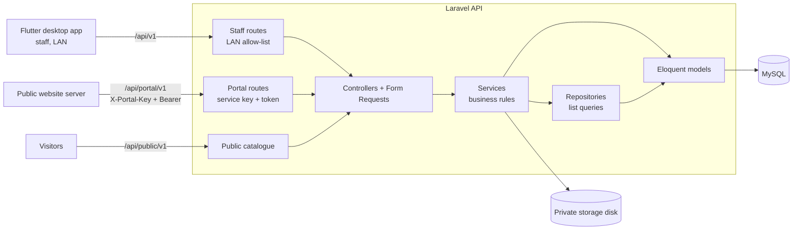

# SOFTEL CRM — Laravel Backend


The REST API behind **SOFTEL CRM**, a customer-relationship system for a software
vendor. It covers the whole customer journey: a prospect comes in, is followed up
and moved through the sales pipeline, gets a demo or a trial, becomes a customer,
then receives updates, after-sales support and maintenance renewals.

The backend is the single source of truth for every business rule. It serves three
clients:

| Client | API | Access control |
|---|---|---|
| Staff desktop app (Flutter, Windows) on the company LAN | `/api/v1` | IP allow-list (LAN only), no staff login |
| Public website, server to server, on behalf of signed-in customers | `/api/portal/v1` | Shared `X-Portal-Key` + customer bearer token |
| Public marketing website (product catalogue) | `/api/public/v1` | None, read-only |

The Flutter app and the website are separate repositories. This repository is the API only.

---

## Contents

- [Features](#features)
- [Technology stack](#technology-stack)
- [Architecture at a glance](#architecture-at-a-glance)
- [Project structure](#project-structure)
- [Getting started](#getting-started)
- [Configuration](#configuration)
- [Running](#running)
- [Testing and code style](#testing-and-code-style)
- [Deployment](#deployment)
- [Documentation](#documentation)
- [Security](#security)
- [Contributing](#contributing)
- [License](#license)

## Features

**Sales**
- Prospects with company profile, contacts, sources, product interests, soft deletes, search and filters.
- A configurable pipeline: stages live in the database and behaviour depends only on `stage_type` (`open`, `won`, `lost`), never on a stage name.
- Moving to a `lost` stage needs an active loss reason (and a note when the reason requires one). Every transition is recorded in the stage history.
- Append-only activities (calls, meetings, messages, notes) and follow-up tasks that can be completed, cancelled or converted into activities.
- Dashboard summary and an analytics report endpoint.

**Customers**
- Converting a prospect into a customer, time-limited software trials (activate and revoke).
- Products, product packs, a multilingual public catalogue, downloadable resources, and product releases with installer uploads.
- Cash-only billing: maintenance subscriptions, renewal requests and quotes, invoices, scanned receipts. A daily command flags expired subscriptions.

**Scheduling**
- Calendar availability from configurable working days, hours and slot length.
- Appointments (demos, training, accompaniment series) with holds, confirmation, proposals, rescheduling, no-shows and conflict detection. A per-minute command releases expired holds.

**After-sales support**
- Interventions with a configurable workflow (types, statuses, allowed transitions, priorities), a message timeline with attachments, and publishing to the customer.

**Customer portal** (`/api/portal/v1`)
- Sign-up, sign-in, Google sign-in (identity validated by the website server), e-mail verification codes and password reset.
- Profile and onboarding, requests (demo or trial), appointments to accept or decline, trials, owned products, releases, billing and interventions.

**Operations**
- Workstation presence: the desktop app sends heartbeats and an optional `X-Employee-Name` header used to attribute work (an audit label, not authentication).
- Multilingual WhatsApp message templates and settings help (`en`, `fr`, `ar` where translated).
- PowerShell scripts for daily MySQL backups and restore.

## Technology stack

| Layer | Technology |
|---|---|
| Language | PHP 8.2+ (see `composer.json`) |
| Framework | Laravel 12 |
| Database | MySQL 8 (production), SQLite in memory (tests) |
| Tests | PHPUnit 11 feature tests |
| Code style | Laravel Pint |
| Production server | Apache as a Windows service on the LAN (see [docs/DEPLOYMENT_LAN.md](docs/DEPLOYMENT_LAN.md)) |

No third-party Composer packages are used beyond the Laravel skeleton: authentication
tokens, rate limiting and file storage are built on framework features.

## Architecture at a glance



Requests are validated by Form Requests, business rules live in `app/Services`, and
every `/api` response, including errors, uses one JSON envelope. Details in
[ARCHITECTURE.md](ARCHITECTURE.md).

## Project structure

```text
app/
  Console/Commands/      scheduled commands (hold release, subscription sync)
  Enums/                 stage types, activity types, statuses
  Exceptions/            BusinessRuleException and the JSON error renderer
  Http/
    Controllers/Api/V1/      staff API
    Controllers/Api/Portal/  customer portal API
    Controllers/Api/PublicApi/ public catalogue
    Middleware/          LAN allow-list, portal service key, portal token
    Requests/Api/V1/     input validation
    Resources/Api/V1/    response shapes
  Models/                Eloquent models
  Repositories/          filtered and paginated list queries
  Services/              business rules
config/
  crm.php                runtime settings (networks, limits, scheduling defaults, portal, uploads)
  crm_seed.php           initial stages, loss reasons, products
  crm_templates.php      default message templates
  crm_help.php           settings help content
  wilayas.php            Algerian provinces
database/
  migrations/            schema
  seeders/               idempotent reference data (+ demo data outside production)
deploy/                  Apache virtual host example
docs/                    API reference and operations guides
routes/
  api.php                staff API (/api/v1)
  portal.php             portal and public APIs
  console.php            scheduler
scripts/                 PowerShell backup and restore
tests/Feature/           feature tests
```

## Getting started

### Requirements

| Component | Version | Notes |
|---|---|---|
| PHP | 8.2 or later (8.3+ for development: the locked Pint needs it) | extensions `pdo_mysql`, `mbstring`, `openssl`, `fileinfo`, `curl`, `zip`, `intl`; `pdo_sqlite` and `gd` to run the tests |
| Composer | 2.x | |
| MySQL | 8.0 or 8.4 | InnoDB, `utf8mb4` |

On Windows, PHP can be installed with `winget install --id PHP.PHP.8.3 -e`; then
create `php.ini` from `php.ini-production`, enable the extensions above and check
with `php -m`.

### 1. Create the database

As MySQL `root`:

```sql
CREATE DATABASE softel_crm CHARACTER SET utf8mb4 COLLATE utf8mb4_unicode_ci;
CREATE USER 'softel_crm'@'localhost' IDENTIFIED BY 'choose-a-strong-password';
GRANT ALL PRIVILEGES ON softel_crm.* TO 'softel_crm'@'localhost';
FLUSH PRIVILEGES;
```

If the root password is unknown, see [docs/MYSQL_ACCESS_RECOVERY.md](docs/MYSQL_ACCESS_RECOVERY.md).

### 2. Install the application

```bash
git clone https://github.com/khaledbouhoun/CRM-Softel-Backend.git
cd CRM-Softel-Backend
composer install                 # production: composer install --no-dev --optimize-autoloader
cp .env.example .env             # Windows: copy .env.example .env
php artisan key:generate
```

Edit `.env` (see [Configuration](#configuration)), then:

```bash
php artisan migrate
php artisan db:seed
```

### 3. Seed data

`php artisan db:seed` is idempotent (matched by name, never overwrites) and loads:

- sales stages, loss reasons and products from [config/crm_seed.php](config/crm_seed.php). The stages are a minimal placeholder pipeline; adjust them before the first seed or later from the app;
- prospect form options and the portal defaults (appointment types, intervention workflow, message templates);
- **demo data** (fictitious prospects, appointments, interventions) — only when `APP_ENV` is not `production`.

## Configuration

`.env.example` documents every variable. The most important ones:

| Variable | Example | Meaning |
|---|---|---|
| `APP_ENV` / `APP_DEBUG` | `production` / `false` | debug must be off in production |
| `APP_URL` | `http://192.168.1.10:8000` | address of the server on the LAN |
| `APP_TIMEZONE` | `Africa/Algiers` | business timezone for storage, "today" and overdue computations |
| `DB_*` | `softel_crm` | MySQL connection; quote the password if it contains `#` or spaces |
| `CRM_ALLOWED_NETWORKS` | `127.0.0.1,::1,192.168.1.0/24` | IPs or CIDR ranges allowed to call `/api/v1`; `*` disables the check |
| `CRM_RATE_LIMIT_PER_MINUTE` | `600` | staff API, per client IP |
| `CRM_ALLOW_REOPENING_CLOSED` | `true` | `false` freezes prospects in won or lost stages |
| `CRM_PORTAL_SERVICE_KEY` | *(long random string)* | enables the portal API; empty = portal disabled (HTTP 503) |
| `CRM_PORTAL_ALLOWED_NETWORKS` | *(website server IP)* | optional extra allow-list for the portal |
| `CRM_PORTAL_TOKEN_TTL_DAYS` | `30` | customer token lifetime |
| `CRM_UPLOAD_DISK` | *(empty)* | storage disk for uploads; empty = default local private disk |
| `CRM_*_MAX_KB` | | upload size limits (staff attachments, installers, receipts) |

After changing `.env` in production, run `php artisan config:cache` again.

## Running

```bash
# Development (single-threaded built-in server)
php artisan serve --host=0.0.0.0 --port=8000

# Scheduler: releases expired appointment holds and syncs subscriptions
php artisan schedule:work          # development
# production: run `php artisan schedule:run` every minute (Windows Task Scheduler)
```

Check that it answers: `GET http://<server-ip>:8000/api/v1/health`.

## Testing and code style

The test suite uses an in-memory SQLite database (configured in `phpunit.xml`), so no
MySQL server is needed.

```bash
php artisan test            # all feature tests
vendor/bin/pint --test      # check code style
vendor/bin/pint             # fix code style
```

Feature tests cover prospects, stage transitions, activities, follow-ups, dashboard and
analytics, configuration protections, customers and trials, booking holds and
appointments, interventions, product packs and releases, billing, the public catalogue,
and portal authentication and security.

## Deployment

The production target is a Windows server on the company LAN:

1. `composer install --no-dev --optimize-autoloader`
2. `.env` with `APP_ENV=production`, `APP_DEBUG=false` and the LAN subnet in `CRM_ALLOWED_NETWORKS`
3. `php artisan migrate --force` and `php artisan db:seed --force`
4. `php artisan config:cache` and `php artisan route:cache`
5. Apache as a Windows service, firewall rule, MySQL bound to localhost
6. The scheduler every minute and the daily backup task

Step-by-step guides: [docs/DEPLOYMENT_LAN.md](docs/DEPLOYMENT_LAN.md) and
[docs/BACKUP_RESTORE.md](docs/BACKUP_RESTORE.md). Always back up before running new
migrations on the production database.

## Documentation

| Document | Content |
|---|---|
| [ARCHITECTURE.md](ARCHITECTURE.md) | Layers, modules, data model, request and authentication flows |
| [docs/API.md](docs/API.md) | Staff API contract (`/api/v1`): envelope, errors, resources, endpoints |
| [docs/PORTAL_AND_WORKFLOWS.md](docs/PORTAL_AND_WORKFLOWS.md) | Customer journey, portal API, billing, public catalogue |
| [docs/portal-onboarding-api.md](docs/portal-onboarding-api.md) | Portal onboarding, profile and request autofill |
| [docs/DEPLOYMENT_LAN.md](docs/DEPLOYMENT_LAN.md) | LAN server, Apache service, firewall, MySQL isolation |
| [docs/BACKUP_RESTORE.md](docs/BACKUP_RESTORE.md) | Daily backups, restore, disaster recovery |
| [docs/MYSQL_ACCESS_RECOVERY.md](docs/MYSQL_ACCESS_RECOVERY.md) | Creating the CRM database user when the root password is unknown |
| [docs/UPGRADE_2026-11-08.md](docs/UPGRADE_2026-11-08.md) | Notes for the 2026-11-08 schema upgrade |
| [CHANGELOG.md](CHANGELOG.md) | Notable changes |

## Security

- The staff API has **no login by design**: it trusts the LAN. Keep `CRM_ALLOWED_NETWORKS` restricted to the office subnet and never expose `/api/v1` to the internet.
- The portal key is a server-to-server secret. Browsers must never receive it.
- Portal tokens, password-reset tokens and e-mail verification codes are stored only as SHA-256 hashes.
- Uploaded files are kept on a private disk and streamed through authorised endpoints.

Report vulnerabilities as described in [SECURITY.md](SECURITY.md).

## Contributing

See [CONTRIBUTING.md](CONTRIBUTING.md).

## License

No license has been chosen for this project yet. Until one is added, all rights are
reserved by the author; please ask before reusing the code.

## Author

Developed by **Khaled Bouhoun** ([@khaledbouhoun](https://github.com/khaledbouhoun)) for SOFTEL.
